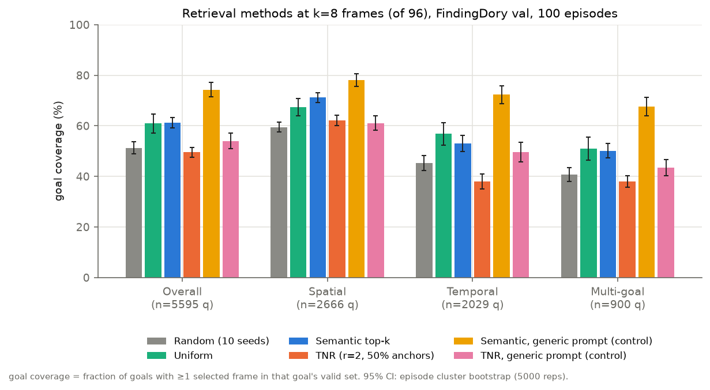

# Temporal-Aware Memory Retrieval for Embodied Agents

A focused, budget-matched retrieval experiment on the **FindingDory** embodied-memory benchmark
(Yadav, Ali, Gupta, Gal, Kira, ICLR 2026). It asks one question: given an agent's 96-frame experience
video and a memory instruction, which *k* frames should be kept in memory?

We compare uniform sampling (the paper's frame-selection strategy), random sampling, CLIP semantic
top-k, and a proposed extension, **Temporal-Neighborhood Retrieval (TNR)**. TNR spends half the budget
on semantic anchors and the other half on their temporal neighbours. Each method is scored on whether
its frames cover the benchmark's ground-truth goal frames. There is no simulator and no training.
A frozen OpenCLIP encoder runs on a laptop.

> Full write-up: [`RESEARCH_REPORT.md`](RESEARCH_REPORT.md). Generated numbers:
> [`results/tables/summary.md`](results/tables/summary.md).

## Main findings (validation split, 100 episodes, 5,595 questions, k = 8 of 96 frames)

| Method | Goal coverage | 95% CI (episode bootstrap) |
|---|---|---|
| Random (10 seeds) | 51.3% | [49.0, 53.7] |
| Uniform | 60.9% | [57.2, 64.6] |
| Semantic top-k (CLIP ViT-B/32) | 61.2% | [59.2, 63.2] |
| **TNR (r = 2, 50% anchors), proposed** | **49.5%** | [47.6, 51.4] |
| Semantic top-k with a fixed generic prompt (control) | 74.3% | [71.6, 77.1] |
| *Post-hoc:* semantic + temporal NMS (gap 4) | 69.1% | [66.5, 71.8] |

1. **The hypothesis is not supported.** TNR lowers goal coverage by **−11.7 pp [−12.7, −10.7]**
   relative to semantic top-k. The loss holds in every task category, at every budget (k = 4–32), and
   on 70 held-out episodes. Contrary to the hypothesis, it is *largest* on temporal tasks (−15.1 pp).
   Frame precision is unchanged (−0.1 pp), so neighbours are not irrelevant. They are **redundant**:
   ground-truth labels are contiguous runs, so a neighbour of a hit adds no new goal, and a neighbour
   of a miss usually misses too. TNR's 8 frames span 3.4 distinct temporal segments, against 6.7 for
   semantic top-k.
2. **Semantic retrieval barely beats uniform sampling** (+0.3 pp overall). It gains only on spatial
   tasks (+3.8 pp) and on categories that name a visual entity (Object Recall +14.5 pp, Object
   Attributes +16.5 pp).
3. **A fixed, question-independent prompt** ("a robot gripper picking up or placing an object") beats
   the actual question by **+13.1 pp**. Most of CLIP's usefulness here is a generic prior that finds
   manipulation frames, not question understanding. Caveat: I wrote this prompt after inspecting the
   label structure on a 30-episode dev subset. It is a diagnostic control, not a proposed method.
4. **Post-hoc, the inverse idea helps:** enforcing temporal *diversity* (suppressing frames within
   ±4 of an already chosen frame) improves semantic retrieval by +7.9 pp, most of all on temporal
   tasks (+11.2 pp). The gap was chosen post hoc from {1, 2, 4, 8}. All four gaps help, but this
   needs confirmation on fresh data.
5. **Encoder-robust.** With OpenCLIP ViT-L/14 every conclusion holds: TNR − semantic = −12.1 pp
   [−13.1, −11.1], semantic − uniform = +1.5 pp (n.s.), and the generic prompt still beats the question.

These are **retrieval-only** results. They measure whether the right viewpoints are kept in memory,
not downstream question answering or embodied task success (see Limitations in the report).



## How this differs from the paper
FindingDory evaluates VLMs that see **uniformly subsampled** videos (16–768 frames) and scores the
whole agent in Habitat. It has no query-conditioned retrieval baseline and no retrieval-only metric.
This project isolates the frame-selection step and measures it directly against the released
ground-truth frame lists, under matched budgets. Details: [`docs/paper_notes.md`](docs/paper_notes.md).

## Reproduce

```bash
uv venv --python 3.11 .venv && uv pip install --python .venv/bin/python -r requirements.txt
source .venv/bin/activate
python -m src.data.inspect_dataset --n-episodes 30 --seed 0   # dataset summary, dev subset, sample figure
python -m scripts.prepare_data          # fetch 100 val videos (~250 MB of range requests) + embed (~1.5 min on M3)
python -m scripts.run_baselines         # every method on one example question (checkpoint)
python -m scripts.run_experiments       # full grid (604k retrievals, ~20 s) + tables + summary.md
python -m scripts.posthoc_diversity     # post-hoc NMS analysis
python -m scripts.make_figures          # figures + qualitative cases
python -m scripts.robustness_encoder    # optional: repeat core comparisons with ViT-L/14
pytest -q                               # 134 tests
```

The videos are never downloaded in bulk. `src/data/load_dataset.py` reads the 3.19 GB `videos.zip`
central directory with HTTP Range requests and extracts single episodes into `data/cache/videos/`.
Embeddings are cached per episode and encoder configuration in `data/cache/embeddings/`. All settings
are in [`configs/experiment.yaml`](configs/experiment.yaml).

## Repository layout
```
src/data/          load_dataset.py (parsing, subset selection, range-request video fetcher), inspect_dataset.py
src/models/        encoder.py (OpenCLIP wrapper: overlay masking, square padding, unit-norm embeddings)
src/memory/        frame_store.py, base.py (retriever interface), uniform/random/semantic/temporal retrievers,
                   diversity_retriever.py (post-hoc)
src/evaluation/    metrics.py (any-hit, goal coverage, precision, recall), statistics.py (episode bootstrap), evaluate.py
src/visualization/ plots.py, frame_visualizer.py
scripts/           prepare_data, run_baselines, run_experiments, posthoc_diversity, make_figures, robustness_encoder,
                   phase3_topk_demo
docs/              paper_notes.md, dataset_notes.md, encoder_notes.md
results/           figures/, tables/ (raw_results.parquet has every retrieval)
tests/             134 tests: budget, duplicates, boundaries, small episodes, invalid frames, r=0 ≡ semantic, metrics, bootstrap
```

## Environment
Apple M3 Pro (18 GB), macOS 26.6, PyTorch 2.15.0 (MPS), Python 3.11.13, open_clip 4.2.2. Encoder
OpenCLIP `ViT-B-32` / `laion2b_s34b_b79k`. Dataset `yali30/findingdory-subsampled-96` at revision
`95afe1e8`. Seeds are fixed throughout (random baseline seeds 0–9, bootstrap seed 0). Exact pins are in
`requirements.txt`.

## Citation and license
The dataset and benchmark belong to the FindingDory authors (Apache-2.0). Please cite:

```bibtex
@article{yadav2025findingdory,
  title={FindingDory: A Benchmark to Evaluate Memory in Embodied Agents},
  author={Yadav, Karmesh and Ali, Yusuf and Gupta, Gunshi and Gal, Yarin and Kira, Zsolt},
  journal={arXiv preprint arXiv:2506.15635},
  year={2025}
}
```
OpenCLIP: Ilharco et al., 2021; LAION-2B: Schuhmann et al., 2022. This repository contains no dataset
videos, model weights or embeddings (see `.gitignore`).
